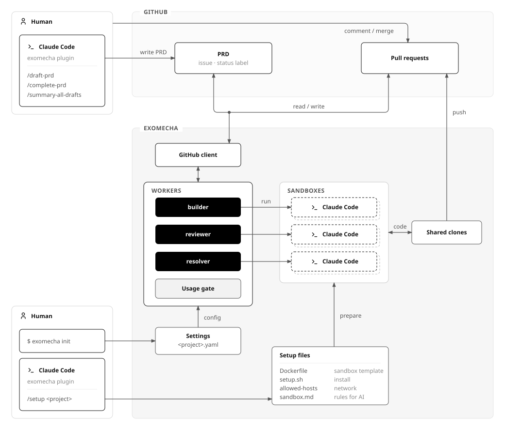
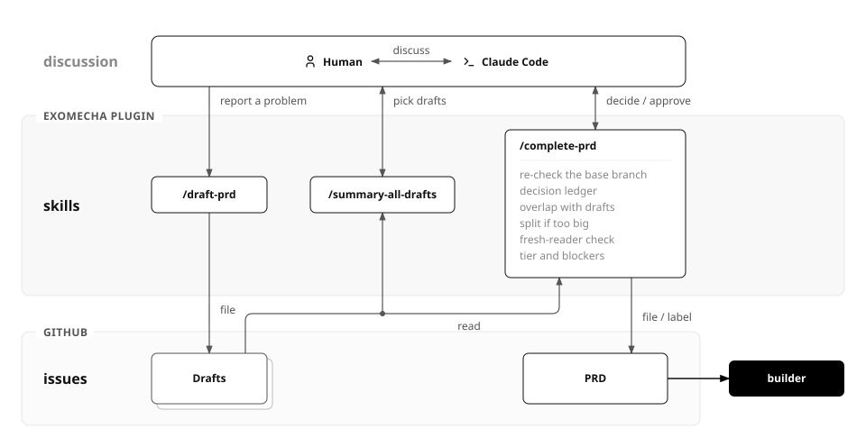
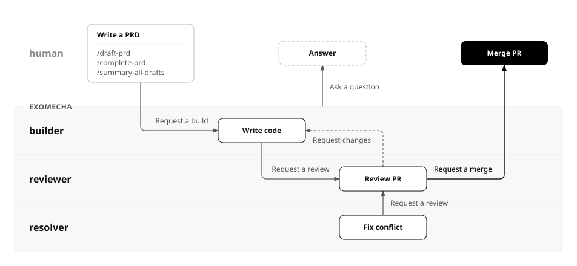

# exomecha

PRD-driven Agent Orchestrator

## Overview

File a PRD as a GitHub issue, and agents write the code, review it and open the PRs. The agents run on your Claude Code subscription, each in an isolated Docker sandbox. You only review the final code and decide whether to merge.



### Working on PRDs

You make PRDs in Claude Code with the exomecha plugin's skills. Use them however you like, as long as you finish with complete-prd, which files the PRD. You can record several problems with draft-prd and sort them out together later with summary-all-drafts, or talk one problem through in depth and call complete-prd right away.

- `/exomecha:draft-prd`: records a problem as a draft. Workers don't take drafts.
- `/exomecha:summary-all-drafts`: shows each draft's title and a summary of up to three lines.
- `/exomecha:complete-prd`: makes every decision and sets the PRD to status:ready.
  - When one PR would be too big, it splits the work into PRDs that can each be merged alone. It marks a PRD that has to wait for another as blocked by it on GitHub. PRDs with nothing blocking them are built at the same time, and a blocked PRD starts once its blockers are merged. You decide the split and its order when you approve.
  - It gives each PRD a tier label by how complex the work is. The model and effort the workers use depend on the tier.
    - light
    - normal
    - heavy



### Workers

builder, reviewer and resolver work on a filed PRD based on its status label.



- `status:draft`: a draft. No worker takes it.
- `status:ready`: builder writes the code and opens the PRs, once no open issue blocks the PRD.
- `status:working`: builder is writing the code and running the tests.
- `status:review`: reviewer reviews the PRs once CI passes, and moves the PRD to status:approved, or back to status:ready when something needs fixing. resolver merges the base branch into a conflicting PR.
- `status:approved`: you merge the PRs in the order builder's summary gives. When a PR conflicts, resolver sends the PRD back to status:review.
- `status:stuck`: a worker is waiting for your decision. Answer its comment and set the label it names.

## Requirements

- macOS or Linux
- git
- Claude Code and a Claude subscription
- sbx (Docker Sandboxes), signed in to Docker and set to the balanced network policy. You don't need Docker Desktop.

  ```
  sbx login
  sbx policy init balanced
  ```

- A GitHub fine-grained token. `exomecha init` gives you a link to create one.
- A CLAUDE.md in each repository that says how to install the dependencies and run the tests. builder follows it in its sandbox.

## Installation

### The machine that runs exomecha

1. Install exomecha.

   ```
   # macOS (Apple silicon)
   curl -fsSLO https://github.com/LeeShinYeoung/exomecha/releases/latest/download/exomecha_darwin_arm64.tar.gz
   tar -xzf exomecha_darwin_arm64.tar.gz
   mkdir -p ~/.local/bin
   install exomecha ~/.local/bin/

   # Linux (x86_64)
   curl -fsSLO https://github.com/LeeShinYeoung/exomecha/releases/latest/download/exomecha_linux_amd64.tar.gz
   tar -xzf exomecha_linux_amd64.tar.gz
   mkdir -p ~/.local/bin
   install exomecha ~/.local/bin/
   ```

2. Create the project. It asks for the settings, checks this machine and installs the exomecha plugin. When it signs sbx in to Claude, use the same account as claude on this machine.

   ```
   exomecha init <project>
   # Asks for:
   # * Repositories exomecha works on
   # * Repository where you file PRDs (with several repositories)
   # * Base branch
   # * GitHub token
   ```

3. Prepare the sandbox in Claude Code and answer the questions it asks.

   ```
   /exomecha:setup <project>
   # Reads each repository's CLAUDE.md, CI and config, and prepares the sandbox to run the tests:
   # * Runtimes and system packages
   # * Dependencies, and config files git ignores (such as .env)
   # * Services such as databases, and migrations
   # * Hosts the sandbox may reach, and access to private package registries
   # * What to do with checks the sandbox cannot run
   # Finally, it starts a real sandbox, runs every check CLAUDE.md and CI ask for, and makes sure they all pass.
   ```

4. Run exomecha. It runs in this terminal until you press Ctrl-C.

   ```
   exomecha run <project>
   ```

### A machine that only writes PRDs

Install the plugin in Claude Code.

```
claude plugin marketplace add LeeShinYeoung/exomecha
claude plugin install exomecha@exomecha
```

## Commands

```
exomecha list        # lists the projects and whether each is running
exomecha update      # updates exomecha and its plugin to the latest release
exomecha --version   # prints the installed version
```

## License

[MIT](LICENSE)
